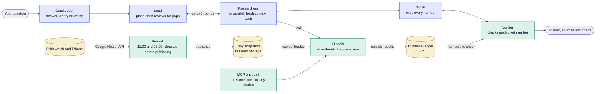
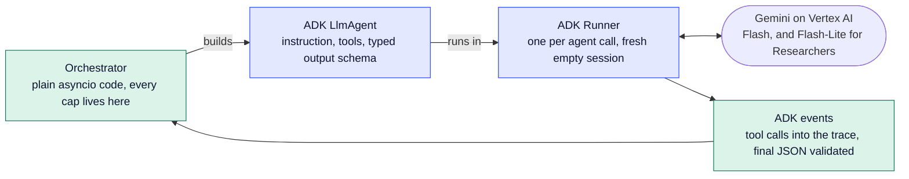
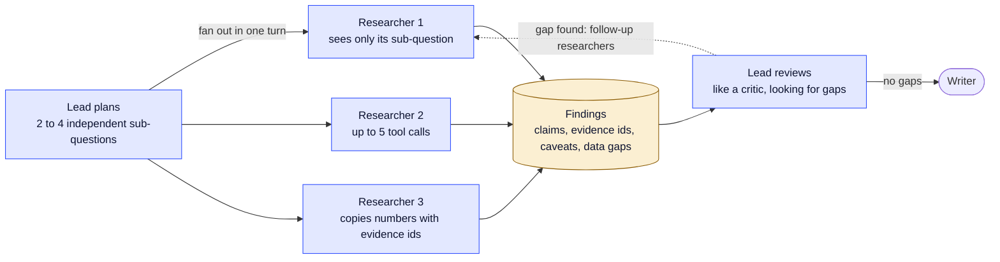
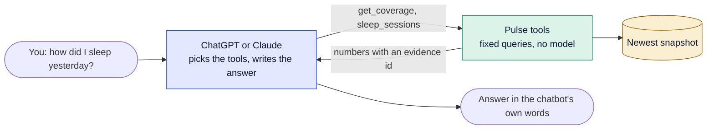
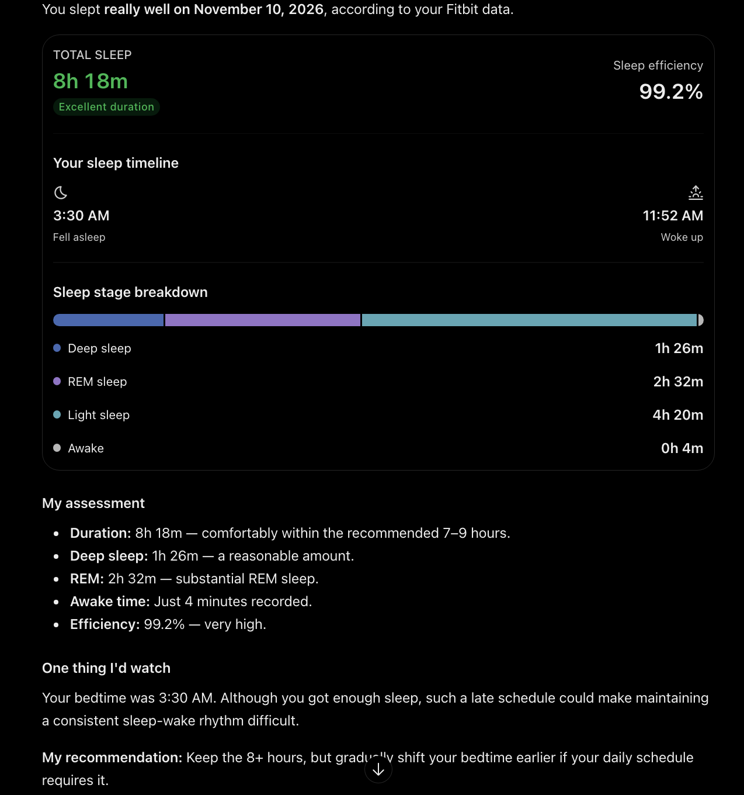

# Pulse: agent-powered analytics for your health data

**Live:** https://pulse-405277086961.us-central1.run.app · **Path:** research · **Author:** sp4553

Pulse answers questions about **one person's own health data from a Fitbit watch and an iPhone**: workouts, heart
rate, sleep and activity. A team of AI agents plans, researches in parallel and writes; code computes every number
and checks every citation before you see the answer. When the data can't answer, Pulse says so, and it never
diagnoses.

**Who it's for:** anyone with a wearable who wants honest answers instead of another dashboard. This demo runs on
the author's own data, refreshed twice a day.

**Questions to try**

1. How hard have my workouts been since I got the watch, and which were the most intense?
2. What's my weekly activity rhythm, and did it change after I started wearing the Fitbit?
3. Am I meeting CDC/AHA targets for activity and sleep, and where can't my data tell?

Also try "How was my workout yesterday evening?", "What time did I go to bed on November 7?", and, as an add-on
(daily New York City weather is joined to the data), "How do temperature and rain change how much I walk?".
A vague question such as "Am I healthy?" gets a clarifying question back; "Do I have sleep apnea?" is declined.

Everything else (requirement mapping, the `/chat` contract, data handling, full sample answers, the evaluation log,
deployment) is in **[docs/DETAILS.md](docs/DETAILS.md)**.

In the diagrams, blue is a model agent, green is plain code with no model, and yellow is data.

---

## 1. How a question is answered, and how the data stays fresh



**Answering (top row)**

- **Gatekeeper** decides whether the data can answer. Vague questions get one clarifying question; diagnoses and
  data that doesn't exist get an honest "no", with what Pulse can answer instead.
- **Lead** splits the question into parts and, later, reviews the findings for gaps.
- **Researchers** each answer one part using the tools. They never do arithmetic themselves.
- **Writer** writes the report from the findings only, citing every number like `[E3]`.
- **Verifier** is code, not a model. It checks that every cited id exists and every number matches its evidence,
  that the limits section is there, and that nothing reads as a diagnosis. A failed check sends the draft back
  once; if it still fails, the answer ships with a visible note.
- **Charts** are drawn by code from the evidence the answer cites, so a chart can't disagree with the text.

**Keeping the data fresh (bottom row)**

- A scheduled job fetches at 11:00 and 23:00, re-fetching only the days that weren't finished at the last fetch.
- It rebuilds one DuckDB snapshot and checks it (no lost days, no date gaps, nothing shrinking) before publishing
  it to Cloud Storage as `snapshots/<day>/pulse.duckdb`. A failed check keeps the previous snapshot.
- The app picks up the newest snapshot within ten minutes, with no redeploy.
- Daily averages use complete days only; today's workouts and sleep appear as soon as they are fetched.
- Every tool result is recorded in the **evidence ledger** under an id, which is what the Writer cites and the
  Verifier checks.

## 2. How Google ADK is used



ADK runs each agent; plain code decides who runs when.

1. **The orchestrator is ordinary Python** ([pulse/orchestrator.py](pulse/orchestrator.py)), not an ADK workflow.
   It holds every limit: rounds, number of Researchers, timeouts.
2. **Each agent is an ADK `LlmAgent`** ([pulse/agents.py](pulse/agents.py)): an instruction, a set of tools and a
   typed output schema. The Lead must return a plan object, a Researcher a findings object.
3. **Each agent call gets its own ADK `Runner` and a fresh, empty session.** That is what gives every agent a clean
   context.
4. **The model is Gemini 3.5 on Vertex AI:** Flash for the Gatekeeper, Lead and Writer; the cheaper Flash-Lite for
   Researchers.
5. **ADK's event stream is read as it runs.** Tool calls go into the `tool_calls` trace with the agent's name, and
   the final JSON is validated before the next step uses it.

The Verifier, the charts and the refresh job are not ADK agents; they are code.

## 3. How the deep researchers work



1. **The Lead plans.** It splits the question into 2 to 4 independent sub-questions, each with its own metrics and
   dates.
2. **Researchers fan out in one turn.** The orchestrator launches them together (`asyncio.gather`), up to 4 at a
   time. Each one sees only its own sub-question, makes up to 5 tool calls, and must copy every number from a tool
   result along with its evidence id.
3. **Each returns a findings object:** claims, evidence ids, caveats, and what the data couldn't answer. A
   Researcher that fails returns an error finding, so it is never silently dropped.
4. **The Lead reviews like a critic.** A gap is a part of the question nobody answered, or a caveat that could
   change the conclusion and that nobody checked. If it finds one, it sends follow-up Researchers.
5. **Hard limits, in code:** 3 rounds, 8 Researchers in total, 200 seconds overall. Then the Writer gets the
   findings.

A real example of the gap loop: asked whether activity changed after the watch arrived, the first Researchers
report that steps doubled. The tools attach a caveat that the watch counts steps the phone missed. On review the
Lead sends a follow-up that repeats the comparison on phone-counted steps only, and the answer leads with that
like-for-like number.

---

## Sample queries and expected answers

Expected values are computed by SQL from the committed snapshot (as of **2026-11-07**). The live app has newer
data, so its counts and totals are higher (for example 33 workouts by 2026-11-10); the method and sources are the
same. Full answers and traces are in [docs/DETAILS.md](docs/DETAILS.md#sample-queries-for-the-grader).

| Question | Expected (as of 2026-11-07) | Source | Same model, no tools |
|---|---|---|---|
| 1. Workout intensity | 29 workouts, 527 minutes, 191 in the vigorous or peak zones. Most vigorous + peak minutes: weights on 11-03 at 19:10 (35), run on 11-01 at 19:19 (22), two ellipticals tied at 21 | `exercise` | "I don't have access to your personal smartwatch… if you can export your workout history…" |
| 2. Weekly rhythm and the watch | Most active Monday, least Wednesday. Raw steps jump 4,161 → 10,197/day at the watch start, but phone-counted steps go 4,161 → 7,036 over 8 days, so part of the jump is measurement | `daily.steps`, `daily.steps_phone` | "I don't have access to your personal Fitbit account…" |
| 3. CDC/AHA targets | 747 Active Zone Minutes in the one judged week (above 150), but one week can't show a habit. Sleep: 5 of 7 nights at 7+ hours. Resting heart rate 62–65 bpm | `daily.azm_total`, `daily.sleep_minutes`, `daily.resting_hr`; references in [data/metrics.yaml](data/metrics.yaml) | Lists the targets and asks the user to paste their stats |

## Data

| Source | What | Loaded by |
|---|---|---|
| Google Health API v4 (Fitbit watch) | workouts with heart-rate zones, heart rate, sleep sessions and stages, HRV, SpO2, Active Zone Minutes | the official `ghealth` CLI with my own OAuth client, [scripts/export_fitbit.sh](scripts/export_fitbit.sh) |
| Apple Health via the same API (iPhone) | steps, distance, floors, active energy, from 2026-08-01 | same export |
| Open-Meteo (add-on) | NYC daily temperature and rain | [build/fetch_weather.py](build/fetch_weather.py) |

[build/refresh.py](build/refresh.py) turns these into one DuckDB snapshot. This is the author's own data, shared
knowingly; weight, body fat and height are excluded, and raw exports and tokens are not in the repo.

## Evaluation

The same checks run in three places: at runtime (the Verifier, on every answer), offline (Inspect AI), and in unit
tests on a synthetic snapshot with known answers.

| Suite | Samples | Result |
|---|---|---|
| End to end | 50 gold questions; answers computed by SQL, independent of the agent's tools | 49 of 50 correct (0.98, margin ±0.14); every answer verified; no errors |
| Gatekeeper | 28 hand-labelled: answer, clarify or refuse | 27 of 28 give the right label in 3 of 3 runs |
| Unit tests | 43 | all pass |

- **Scorers:** deterministic checks first (right status, every gold number present, Verifier passed, fan-out,
  latency), then a judge only where code can't decide: DeepSeek V4.1 Flash, a different model family from the
  agents, majority of 3 votes.
- **The eval set is pinned** to the committed 2026-11-07 snapshot, so answer keys don't move when the live data
  refreshes.
- **What "verified" means:** each cited number appears in the cited evidence record. It does not prove the number
  is attached to the right label, and it is weaker on very wide evidence records.

The hill-climbing log, what was noise and what was real, and the known remaining failures are in
[docs/DETAILS.md](docs/DETAILS.md#evaluations).

## Run it locally

```bash
gcloud auth application-default login     # Vertex AI: Gemini agents and the DeepSeek judge
uv sync
uv run app.py                             # http://localhost:8080  (PORT=8091 uv run app.py for another port)

uv run pytest                             # tool math, Verifier, orchestrator failure handling
uv run inspect eval evals/task.py@e2e --max-samples 4
uv run inspect eval evals/task.py@gatekeeper --epochs 3 --epochs-reducer at_least_3
uv run evals/report.py e2e                # scores with margin of error, and failing samples
```

Without a bucket the app serves the committed snapshot. To use the daily snapshots, set
`PULSE_BUCKET=<bucket>`. To refresh the data yourself (needs your own Google Health OAuth client and `ghealth`):

```bash
uv run build/refresh.py                   # fetch, rebuild, check; add --bucket <name> to publish
scripts/install_schedule.sh               # macOS: run it at 11:00 and 23:00
```

Ask from the command line (same response shape as Project 1, plus `agent` on every tool call):

```bash
curl -X POST http://localhost:8080/chat -H 'Content-Type: application/json' \
  -d '{"message": "How was my workout yesterday evening?"}'
```

## MCP server

The same deterministic tools are served over MCP (streamable HTTP, tools only, no agent loop), so any chatbot can
query the data:

- Live: `https://pulse-405277086961.us-central1.run.app/mcp/`
- Local: `http://localhost:8080/mcp/` while `uv run app.py` is running

Tools: `get_coverage`, `list_metrics`, `get_daily`, `summarize_metric`, `compare_periods`, `compare_groups`,
`correlate`, `check_guideline`, `sleep_sessions`, `workouts`, `workout_heart_rate`.

Connect it (keep the final `/` in the URL; no login is needed):

- **Claude:** *Settings → Connectors → Add custom connector*, then paste the URL.
- **ChatGPT:** turn on *Developer mode* under *Settings → Apps & Connectors → Advanced settings*, create a connector
  with the URL, and choose *No authentication*.
- **By hand:** `npx @modelcontextprotocol/inspector`, then connect to the URL.

### What happens when a chatbot uses the connector

Only the tools run. The chatbot is the agent: it reads the tool list, decides which tools to call, and writes the
answer itself. Pulse's own agents and its Verifier are not involved.



1. On connecting, the chatbot fetches the names and descriptions of the 11 tools.
2. For a question it chooses which to call. Here: `get_coverage`, then `sleep_sessions` for 2026-11-10.
3. The server runs each tool, a fixed query against the newest snapshot, and returns plain numbers.
4. The chatbot writes everything else: the layout, the wording and any judgement.

A real answer from ChatGPT through the connector:



The numbers are Pulse's and match the snapshot (498 minutes asleep, 03:30 to 11:52). "Excellent duration", "My
assessment" and the bedtime recommendation are ChatGPT's own, and nothing checked them.

| | The website (`/chat`) | The MCP connector |
|---|---|---|
| Who plans the work | Pulse's Lead and Researchers, in parallel | The chatbot |
| Who does the arithmetic | Pulse's tools | The same tools |
| Who writes the answer | Pulse's Writer | The chatbot |
| Verifier check on every number | Yes | No |
| "Never diagnose", "say what the data can't tell" | Enforced | Only a hint in the server's instructions |
| Speed | 30 to 60 seconds | A few seconds |

The chatbot can only call these tools with their parameters. It never sees the database or the raw files.

## Deploy

Cloud Run service `pulse` (us-central1), continuously deployed from this repo's `main` branch by Cloud Build using
the [Dockerfile](Dockerfile). Request timeout 600 s, max 1 instance, 1 GiB, public.
